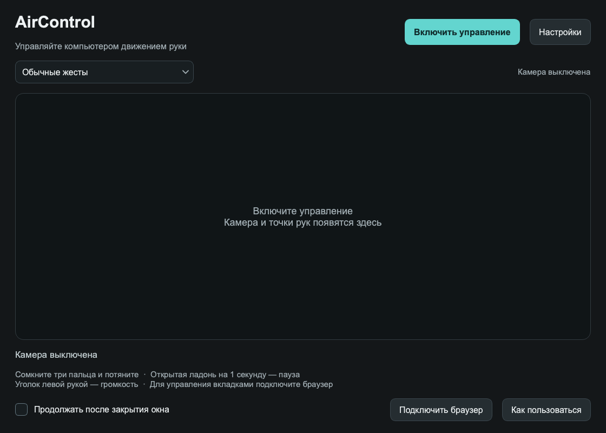

# AirControl

**Управление компьютером движением рук через обычную камеру.**

[English](README.md) · [Лицензия](LICENSE) · [Происхождение](NOTICE.md)



Самостоятельное приложение для macOS: мышь рукой, прокрутка страниц и управление видео. Распознавание работает локально. Учётная запись, API-ключ, микрофон и облачная нейросеть не нужны.

## Что умеет

- Перемещать курсор как тачпадом, нажимать левую/правую кнопку, выделять и перетаскивать.
- Прокручивать захватом трёх пальцев либо двумя вытянутыми пальцами в режиме мыши.
- Выполнять обычные жесты: короткий мах — один шаг, длинный — несколько.
- Плавно тянуть страницу в аналоговом режиме, как пальцем на экране.
- Управлять паузой, перемоткой, громкостью и масштабом.
- Масштабировать двумя руками: сомкните большой и указательный пальцы обеих рук (можно вместе со средним), затем разводите или сближайте кисти, удерживая захваты. Разожмите обе руки перед повтором. Настройка и чувствительность — в разделе «Мышь и курсор»; в системном режиме используются сочетания масштаба активного приложения, в браузерном — выбранная вкладка.
- Отдельно настраивать правую/левую руку, назначения, размах, скорость и ускорение.
- Показывать 21 точку и центр каждой ладони. Из восьми видимых рук управляют крупнейшие правая и левая.
- Работать в фоне; настройки доступны через поиск и разделы, для жестов есть текстовый справочник.
- Использовать кисть как игровой джойстик: проверка на экране, WASD или мышь-джойстик. Это экспериментальный режим для Mac.

Это ранняя публикация исходников. Приложение проверялось на Mac с Apple Silicon и Python 3.11. Готовые сборки для Windows и Android в эту версию не входят. Дрожание и пропуски ещё возможны; устойчивость зависит от освещения, ракурса и видимости кисти.

## Установка

Нужны macOS, Python **3.11**, камера и Xcode Command Line Tools с `swiftc`. Для установки библиотек и модели нужен интернет; загрузка модели проверяется по SHA256.

```sh
git clone https://github.com/KornejYE/aircontrol.git
cd aircontrol
python3.11 scripts/setup.py
Runtime/bin/python Source/main.py
```

Нажмите **«Включить управление»**. При первом использовании macOS запросит камеру. Для системной мыши также нужен доступ в «Конфиденциальность и безопасность → Универсальный доступ».

Для сборки приложения:

```sh
Runtime/bin/python scripts/build_macos.py
```

Оно появится в `~/Applications/AirControl.app`. Существующая сборка не перезаписывается; другой путь задаётся через `--output`. Приложение использует Python, установленный на том Mac, где собиралось. Для другого компьютера его нужно собрать там; готового переносимого и нотарифицированного пакета в этом выпуске нет.

## Мышь рукой

| Действие | Жест |
| --- | --- |
| Курсор | Двигайте и наклоняйте кисть; указательный можно слегка согнуть |
| Левый клик | Соедините большой и указательный, затем разомкните |
| Перетаскивание | Удерживайте щипок большого и указательного и перемещайте кисть |
| Правый клик | Соедините большой и средний, указательный оставьте вытянутым; коротко удержите |
| Прокрутка | Сведите большой, указательный и средний, затем ведите кисть вверх/вниз; два вытянутых пальца тоже прокручивают |
| Остановка | Кулак останавливает курсор и отпускает кнопку |
| Отключение мыши | Esc; для продолжения выключите и включите управление |

В обычном и аналоговом режимах неподвижная открытая ладонь на секунду переключает паузу. Уголок левой рукой по умолчанию управляет громкостью. Полный справочник открывается кнопкой **«Как пользоваться»**.

Ускорение по умолчанию выключено. Обычная мышь временно получает приоритет.

## Расширение браузера

В приложении нажмите «Подключить браузер». Откройте `chrome://extensions` либо `edge://extensions`, включите режим разработчика и загрузите папку `BrowserGestures` как распакованное расширение. В его панели нажмите «Включить управление» и разрешите доступ к нужным страницам.

Можно выбрать вкладку, окно или весь браузер. Настройки находятся за кнопкой **⋯**. В автоматическом режиме YouTube Shorts используют обычные жесты, остальные страницы — аналоговые. Видимым видео можно управлять, пока активна игра на другом экране. [Инструкция расширения](BrowserGestures/README.md).

Для системной мыши расширение не требуется.

## Игровой джойстик

Выберите **«Игровой джойстик» → «Настроить джойстик»**. По умолчанию доступна только проверка на экране: ввод в игру выключен.

1. Выберите правую или левую руку. По умолчанию хват — **кулак**, движение — **наклон**. Поставьте кулак ребром на стол и удержите прямо около 0,2 секунды: это задаст нейтраль.
2. Наклоняйте кисть вправо, влево, вперёд и назад, как ручку джойстика. Для полного отклонения не нужно перемещать всю руку. Чувствительность задаётся углом в градусах и мёртвой зоной.
3. Раскройте ладонь, уберите руку или нажмите Esc для остановки. После Esc выключите и включите управление, чтобы продолжить.
4. Для игрового ввода выберите запущенную игру и способ вывода. Команды поступают только когда эта игра на переднем плане. После смены окна или настроек нужен новый захват.

Предыдущий способ доступен как **«Щипок» + «Перемещение всей кисти»**. Наклон использует 3D-точки руки; обычные режимы мыши и прокрутки сохраняют свои настройки. Если камера не находит уже закрытый кулак, сначала ненадолго покажите раскрытую руку и затем сожмите её.

### Обычная ручка без метки

Нажмите **«Выбрать ручку без метки»** справа от камеры. Обведите её видимый конец или колпачок вместе с краями, затем подтвердите выбор. За следующие пять секунд переключитесь в игру и установите ручку в удобную нейтраль: после отсчёта начнётся управление. Распознавание пальцев для этого способа не используется; OpenCV CSRT отслеживает внешний вид выделенного участка локально.

Отслеживается **движение конца ручки в изображении**, а не её точный 3D-наклон. Фон должен отличаться от предмета; пальцы не должны закрывать выбранный участок. При потере, резком скачке или заметном изменении внешнего вида ввод останавливается; заново выделите ручку. Изображение предмета хранится только в памяти до выключения камеры. После перезапуска камеры нужно выбрать его снова.

Кнопка **«Новая нейтраль»** даёт пять секунд на переустановку руки. **Esc** или **«Остановить джойстик»** прекращают ввод. После смены окна верните ручку в нейтраль примерно на полсекунды для продолжения; остановку по Esc нужно снять кнопкой «Новая нейтраль». Источник отслеживания и размах ручки настраиваются в разделе «Игровой джойстик».

**Танки · WASD:** удержание направления кистью удерживает соответствующую клавишу, включая диагонали. Это клавиатурное управление, без плавной силы нажатия и повторяющихся макросов.

**Самолёты · мышь-джойстик:** кисть задаёт плавное положение мыши относительно центра монитора, на котором находится курсор в начале захвата. В War Thunder нужно отдельно выбрать встроенный режим «Мышь-джойстик», включить полноэкранный режим и оставить нейтраль джойстика в центре экрана. Радиус и инверсия вертикальной оси настраиваются. Отпускание захвата возвращает мышь в центр, пока игра активна. Физическая мышь получает приоритет. Управление оружием не добавлено.

Это **не виртуальный HID-геймпад** и не отдельные оси Xbox-контроллера. Драйверы, чтение памяти игры и вмешательство в её процесс не используются. Совместимость с War Thunder в бою и его античитом не подтверждена. [Gaijin запрещает автоматизацию и средства, дающие нечестное преимущество](https://legal.gaijin.net/codeofconduct); отсутствие блокировки не гарантируется. Для разрешения именно этой программы обратитесь в поддержку игры. Не обходите ограничения античита.

## Данные

Кадры обрабатываются на компьютере, не записываются приложением и не передаются в облако. Расширение получает команды, а не видео или звук. Настройки лежат в `~/Library/Application Support/AirControl`. Личные профили, логи, библиотеки и веса модели в Git не включены. [Подробнее](PRIVACY.md).

## Лицензия и авторство

Сохранена **CC BY-NC 4.0** исходного проекта MARK LV — JARVIS / [FatihMakes](https://github.com/FatihMakes/Mark-LV). Использование — некоммерческое, с сохранением авторства и условий лицензии. Изменения AirControl и сторонние компоненты перечислены в [NOTICE.md](NOTICE.md). Текст лицензии: [LICENSE](LICENSE).
